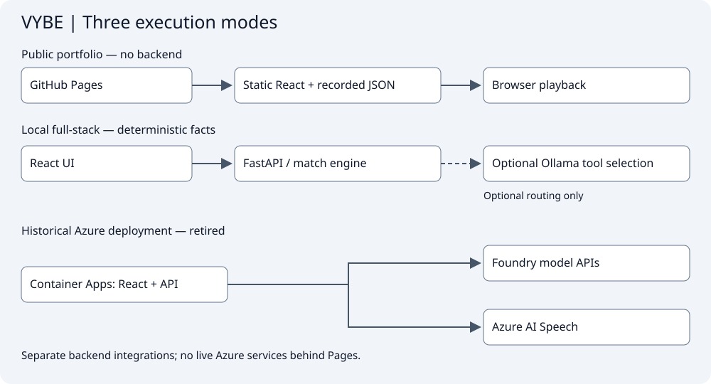

# VYBE — Every Fan Belongs

**One synthetic football match. Three ways to experience it.**

VYBE turns a **fictional football match** into three personalized fan experiences: **Young Fan**, **Accessible Fan**, and **Analyst Fan**. The current public portfolio is a static replay with recorded deterministic content. Local full-stack execution supports optional Ollama tool selection. The retired Azure hackathon integration and its owner-observed evidence are preserved separately.

**[Watch the final 75-second demo (uploaded to YouTube)](https://youtu.be/-pfgaeGjSN8)** · **[Archived judges' testing guide](docs/archive/JUDGES_TESTING_GUIDE.md)** · **[Static portfolio demo](https://hapinam.github.io/vybe-ai/)** (historical Azure deployment evidence: [production Foundry observations](docs/archive/VYBE_FOUNDRY_LIVE_EVIDENCE_2026-10-25.md))

> **Synthetic data only:** Aurora FC, Harbor United, players and events are fictional. No official Premier League feed or real-time match coverage. Browser speech is not AI translation.

## Project status and execution modes

Active hackathon development ended on 24 November 2026. The public portfolio remains available; maintenance is subject to owner review.

| Mode | Runtime | AI |
| --- | --- | --- |
| Public portfolio | GitHub Pages, static frontend | Recorded deterministic content; browser speech |
| Local full-stack | React and FastAPI | Deterministic by default in the recommended setup; optional Ollama |
| Historical Azure | Retired Container Apps deployment | Foundry model APIs and Azure Speech were configured historically |

See [local development](docs/LOCAL_DEVELOPMENT.md) and [testing and security](docs/TESTING_AND_SECURITY.md).

### Quick tour

1. **Young Fan:** goals, celebrations, glossary and quiz.
2. **Accessible Fan:** English/Arabic/Czech captions, larger text, contrast, keyboard and step-by-step playback.
3. **Analyst Fan:** recorded match statistics, 15-minute weighted event activity and timeline filters.

### Product vision and future roadmap

- **[Archived future vision: multilingual expansion, caching, personalization, event processing and reliability](docs/archive/PRODUCT_VISION_ROADMAP.md)** — proposed capabilities only; not implemented in the current demo.

### Demo links

- [Static portfolio demo](https://hapinam.github.io/vybe-ai/)
- [Final 75-second demo](https://youtu.be/-pfgaeGjSN8)
- [Archived judges' guide](docs/archive/JUDGES_TESTING_GUIDE.md)
- [Technical architecture](docs/ARCHITECTURE.md)

## Experiences

| Persona | Features |
| --- | --- |
| **Young Fan** | Goal celebration, plain-language football glossary, interactive goal quiz, approachable match commentary |
| **Accessible** | Recorded narration in static portfolio; historical Azure AI Speech with browser fallback, adjustable voice speed, high-contrast mode, larger text, keyboard replay shortcuts, optional descriptions of shots and passes, screen-reader-friendly step-by-step event navigation |
| **Analyst** | Recorded shots/passes, highlights/goals/all-events timeline filters, first-vs-second-half comparison, event-based momentum indicator, goal turning points and evidence-backed narratives |

**Interpreting analytics:** Momentum is a custom weighted event-activity score (goal = 3, shot = 2, completed pass = 1) in 15-minute windows. It is **not** possession, expected goals (xG), or a professional tactical model. Half comparisons use recorded synthetic events only; missing events must not be interpreted as real-world zero activity.

## Architecture

- **Frontend:** React, TypeScript, Vite, CSS. The public static portfolio uses recorded narration and optional browser speech; the historical full-stack implementation supported server-side Azure Speech MP3.
- **Backend:** Python FastAPI; deterministic replay engine that calculates score, passes and shots from ordered synthetic events.
- **Narration:** Evidence-based, persona-specific commentary. Historical full-stack Foundry integration could select verified fact segments; the public static portfolio plays recorded content, without live AI inference.
- **Data:** Local synthetic match fixture. No external sports API required.

The Vite development server proxies `/v1` and `/health` to the FastAPI service on port **8000**. Playback requests all validated replay snapshots once via `/v1/matches/replay/states` and then scrubs locally; `/v1/matches/replay` remains available for individual queries.

## Architecture diagram

The three execution modes are distinct. See [technical architecture](docs/ARCHITECTURE.md) for detailed diagrams and historical evidence.



**Data boundaries:** No official or live Premier League feeds are used. Match statistics derive from fictional events; browser fallback speech uses installed OS/browser voices. The adapter's existence alone is not evidence of Azure model execution or managed Foundry Agent Service. The Azure Container Apps deployment has been retired; the recorded static portfolio is the intended public demonstration. Owner-supplied production network responses reported `foundry_model_tool_call` and `azure_ai`; these do not independently prove Azure-side token usage or a managed agent. See [live evidence and its limits](docs/archive/VYBE_FOUNDRY_LIVE_EVIDENCE_2026-10-25.md).

## Run locally (Windows PowerShell)

**Prerequisites:** Python 3.11+ (CI tests 3.11 and 3.13), Node.js 22 and npm. No Azure keys are needed for deterministic replay. Foundry model selection, Azure AI goal narration and Azure Speech require separate server-side configuration; without compatible credentials the app uses safe fallbacks. Do not place keys in `VITE_` variables.

For optional cloud-enabled testing (not required for local operation), configure `VYBE_FOUNDRY_MODEL_ENDPOINT`, `VYBE_FOUNDRY_MODEL_DEPLOYMENT`, `VYBE_FOUNDRY_MODEL_KEY` (Ask the Match), and separately `VYBE_AZURE_OPENAI_ENDPOINT`, `VYBE_AZURE_OPENAI_DEPLOYMENT`, `VYBE_AZURE_OPENAI_KEY` (goal narration). For speech see [Azure Speech rollout](docs/archive/AZURE_SPEECH_ROLLOUT.md). Never commit secrets.

Use two terminals from the repository root.

**Terminal 1 — API**

```powershell
cd apps/api
python -m venv .venv
.\.venv\Scripts\python.exe -m pip install --require-hashes -r requirements-test.lock
.\.venv\Scripts\python.exe -m pip install --no-deps -e .
.\.venv\Scripts\python.exe -m pip check
$env:VYBE_DIRECTOR_PROVIDER = "deterministic"
.\.venv\Scripts\python.exe -m uvicorn vybe.main:app --reload --port 8000
```

**Terminal 2 — frontend**

```powershell
cd apps/web
Remove-Item Env:VITE_DEMO_MODE -ErrorAction SilentlyContinue
npm.cmd ci
npm.cmd run dev
```

Open **http://localhost:5173** (or the port Vite prints if 5173 is occupied).

## Existing implementation evidence

The project includes development checks and historical validation results. Production Foundry and speech observations are documented in the [October 25 evidence summary](docs/archive/VYBE_FOUNDRY_LIVE_EVIDENCE_2026-10-25.md). These are records of completed work, not extra submission requirements.

## New fan experiences

- **Multilingual commentary:** English, Arabic and Czech event captions, summaries and browser speech narration in Accessible mode. These are deterministic translations of synthetic events, **not Azure AI translations**. Browser voices for Arabic and Czech may not be installed.
- **Live captions:** optional text for the current match event, updated as playback progresses. Captions are event-synchronized rather than word-by-word speech transcription.
- **Match story recap:** evolving event-grounded score and goal narrative for all personas.
- **Timeline views:** Highlights, Goals-only, and All events; the Goals view shows goal events without changing the underlying match statistics.
- **Interactive match insights:** select a 15-minute Analyst momentum bucket to filter timeline events; select again or clear to reset.
- **Fan preferences:** language, persona, high contrast, large text, captions, timeline display, expanded narration and voice speed saved in the current browser using localStorage when permitted; the app continues without persistence when storage is blocked. No account or cloud sync.
- **Guided demo:** short automated tour of Young, Accessible and Analyst using selected synthetic events; no Azure resources needed.

## Accessible controls

In Accessible mode, enable **Step-by-step playback (screen reader friendly)** to pause automatic event progression and move between events with **Previous event** and **Next event**. This allows an external screen reader to finish reading captions before the next event; the app cannot detect when Narrator finishes speaking. The setting persists in the current browser.

In Accessible mode, **Tab** navigates controls. When focus is not inside an interactive control, **Space** toggles playback and **Left/Right arrows** step through events. Spoken commentary is optional and depends on the installed browser and operating-system voices. Voice-speed changes apply to the next utterance, not the current one.

## Local Ollama Director

VYBE supports optional local Ollama tool selection for Ask the Match. The model selects from allowlisted, read-only tools. The deterministic match engine remains the source of truth for answers and evidence.

Start Ollama and ensure the configured model is available. In the API terminal, set:

```powershell
$env:VYBE_DIRECTOR_PROVIDER = "ollama"
$env:VYBE_OLLAMA_BASE_URL = "http://127.0.0.1:11434"
$env:VYBE_OLLAMA_MODEL = "qwen3-coder:30b"
```

Then start FastAPI using the local setup instructions above.

The default provider is `foundry`. Set `VYBE_DIRECTOR_PROVIDER=deterministic` to disable model-based tool selection. Provider failures use deterministic fallback.

## Static portfolio demo (GitHub Pages)

VYBE includes a frontend-only portfolio build using recorded synthetic replay states, narrations, insights and answers to the five suggested Ask the Match questions.

This mode does not run FastAPI, Ollama, Microsoft Foundry or Azure AI inference. Other questions receive a static-demo limitation response.

From `apps/web` in Windows PowerShell:

```powershell
npm.cmd ci
$env:VITE_DEMO_MODE = "static"
npm.cmd run build
npm.cmd run preview
```

The static build uses `/vybe-ai/` as its GitHub Pages base path.

This is a recorded portfolio demonstration, not live AI inference or a real-time football-data service. GitHub Pages is the current public static portfolio, published through a dedicated workflow.

## Deployment status

The original hackathon deployment used Azure Container Apps, Microsoft Foundry and Azure AI Speech. The Azure resources have since been deleted, and the former live application URL is no longer active.

The public portfolio version is a frontend-only static demonstration hosted on GitHub Pages. It uses recorded synthetic match data and does not require a backend, Azure services or Ollama.

The historical deployment architecture and implementation evidence remain documented in [Azure deployment README](docs/archive/infra/azure/README.md), [GHCR deployment](docs/GHCR_DEPLOYMENT.md) and [production Foundry evidence](docs/archive/VYBE_FOUNDRY_LIVE_EVIDENCE_2026-10-25.md).

## Azure integration

The historical hackathon submission used Microsoft Foundry-hosted model integration and Azure AI Speech; these cloud services are not running behind the current public portfolio. See [Foundry implementation](docs/archive/FOUNDRY_REQUIRED_LAUNCH.md) and [production evidence](docs/archive/VYBE_FOUNDRY_LIVE_EVIDENCE_2026-10-25.md). The deterministic engine remains the source of match facts.

## Limitations and responsible use

- Not real football match data, real-time video or an official Premier League product.
- AI-generated or AI-assisted descriptions are experimental; the deterministic event engine is the source of truth for match scores.
- Browser speech voices vary, and expanded narration needs manual timing/accessibility validation.
- Goal-based turning points are illustrative, not causal tactical analysis.
- This is a hackathon prototype, not a certified production football-data service.

## Documentation

See the [documentation index](docs/DOCUMENTATION_INDEX.md) for active documentation and preserved historical records.

## Project layout

- `apps/api/` — FastAPI routes, match engine and tests
- `apps/web/` — React replay dashboard and personas
- `apps/web/src/match.ts` — synthetic match fixture and frontend types

## Historical hackathon demo outline

1. Introduce the same fictional match and the three personas.
2. Play a goal in Young Fan mode; show the celebration and football word explanation.
3. Switch to Accessible; demonstrate high contrast, large text, keyboard navigation and optional narration.
4. Switch to Analyst; inspect half-by-half counts, weighted momentum and turning points.
5. Show Ask the Match's evidence IDs and explain bounded Foundry model tool selection versus deterministic fallback; see the documented owner-observed production responses, and do not claim independently verified Azure inference logs.

**Every fan belongs. Every moment matters.**

## Dependency lockfile compatibility

The runtime and test lockfiles were generated on Linux
with Python 3.11. Hash-enforced installation and API tests
were validated in Linux containers using Python 3.11 and
3.13.

Native Windows installation has not been independently
validated with these lockfiles.

If installation fails on Windows, use a compatible Linux
environment or the documented Docker setup. Do not
silently bypass package hash verification.

For entirely local execution, use a clean environment
without Azure model or speech credentials. Setting the
Director provider to deterministic does not independently
disable cloud narration or speech.

## Research and engineering evidence

VYBE preserves 79 historical research artifacts covering
model evaluation, security robustness and speech research.

The HTTP application contract benchmark evaluated 20 models
across 240 recorded executions. Qwen3 Coder and Gemma 4 12B
passed all 12 cases in that benchmark.

The separate three-model robustness evaluation contains
72 recorded executions. No finalist passed every case.

These are application-specific historical results, not
general-purpose LLM rankings or security certification.

- [Research findings](research_evaluation/FINDINGS.md)
- [Research archive and preservation policy](research_evaluation/README.md)
- [Final security audit](docs/SECURITY_AUDIT_REPORT.md)
- [Project closure status](docs/PROJECT_CLOSURE_STATUS.md)
