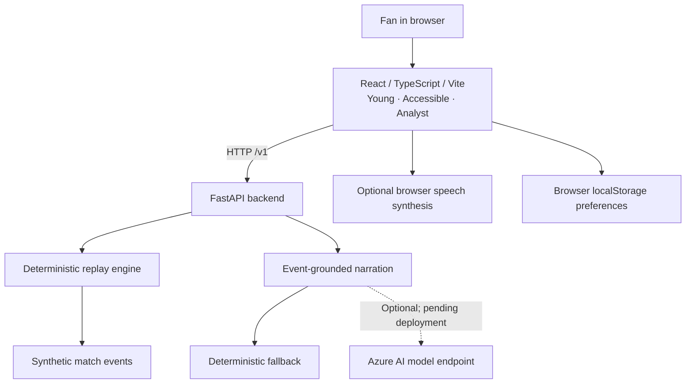

# VYBE — Every Fan Belongs

**One synthetic football match. Three ways to experience it.**

VYBE is an accessibility-first football replay prototype for the **Microsoft + Premier League Inside the Game Developer Hackathon 2026**. It presents the same fictional Aurora FC vs Harbor United match through different experiences, with grounded event data and an optional Azure AI narration integration.

> **Synthetic demo only:** Teams, players and match events are fictional. This project does not use official Premier League match feeds or claim real-time match coverage.

## Experiences

| Persona | Features |
| --- | --- |
| **Young Fan** | Goal celebration, plain-language football glossary, interactive goal quiz, approachable match commentary |
| **Accessible** | Optional browser spoken commentary, adjustable voice speed, high-contrast mode, larger text, keyboard replay shortcuts, optional descriptions of shots and passes, screen-reader-friendly step-by-step event navigation |
| **Analyst** | Recorded shots/passes, highlights/goals/all-events timeline filters, first-vs-second-half comparison, event-based momentum indicator, goal turning points and evidence-backed narratives |

**Interpreting analytics:** Momentum is a custom weighted event-activity score (goal = 3, shot = 2, completed pass = 1) in 15-minute windows. It is **not** possession, expected goals (xG), or a professional tactical model. Half comparisons use recorded synthetic events only; missing events must not be interpreted as real-world zero activity.

## Architecture

- **Frontend:** React, TypeScript, Vite, CSS; browser SpeechSynthesis API for optional spoken commentary.
- **Backend:** Python FastAPI; deterministic replay engine that calculates score, passes and shots from ordered synthetic events.
- **Narration:** Evidence-based, persona-specific commentary; optional Azure AI configuration where supported, with deterministic fallback.
- **Data:** Local synthetic match fixture. No external sports API required.

The Vite development server proxies `/v1` and `/health` to the FastAPI service on port **8000**.

## Architecture diagram

This diagram shows the **current local prototype**. The Azure AI endpoint is optional and **not yet deployed**.



**Data boundaries:** No official or live Premier League feeds are used. Match statistics derive from fictional events; browser speech uses installed OS/browser voices. The optional Azure integration is not evidence of a deployed service. Azure deployment topology will be documented after live validation.

## Run locally (Windows PowerShell)

Use two terminals from the repository root.

**Terminal 1 — API**

```powershell
cd apps/api
python -m venv .venv
.\.venv\Scripts\python.exe -m pip install -e ".[test]"
.\.venv\Scripts\python.exe -m uvicorn vybe.main:app --reload --port 8000
```

**Terminal 2 — frontend**

```powershell
cd apps/web
npm.cmd install
npm.cmd run dev
```

Open **http://localhost:5173** (or the port Vite prints if 5173 is occupied).

## Validation (automated and manual checks)

```powershell
cd apps/web
npm.cmd run build
```

```powershell
cd apps/api
.\.venv\Scripts\python.exe -m pytest tests -q
```

**Windows PowerShell vs Command Prompt (CMD):** PowerShell may block the `npm.ps1` or `npx.ps1` script with an execution-policy error. Use the `.cmd` launchers instead; no execution-policy change or administrator access is needed. In **CMD**, **Git Bash**, and **Linux/macOS** shells, use the normal `npm` and `npx` commands (on Git Bash, `.cmd` is generally unnecessary). The commands below assume you are inside `apps/web`:

```powershell
# Windows PowerShell
npm.cmd ci
npm.cmd run dev
npm.cmd run build
npx.cmd playwright test
```

```sh
# Windows CMD, Git Bash, Linux or macOS
npm ci
npm run dev
npm run build
npx playwright test
```

Playwright browser setup (first time): `npx.cmd playwright install chromium` in PowerShell, or `npx playwright install chromium` in other shells. The Playwright configuration starts the Vite dev server automatically during tests. Browser speech is mocked in the automated full-time test; audible speech still requires manual browser/OS verification.

**Historical validation — October 12, 2026:** 43 local backend tests passed, the frontend production build passed, and the API/Web/Container GitHub CI checks passed for merged PR #15. FastAPI and Vite started locally; Arabic Accessible/Guided Demo narration and Play/Pause were confirmed by manual testing in Chrome with the installed Microsoft Hoda (`ar-EG`) voice. The voice was understandable Arabic but not perceived as a natural Egyptian dialect.

**October 12 accessibility update:** Mobile Chrome viewport (393×852) was checked for horizontal overflow and responsive controls; keyboard navigation and Windows Narrator controls passed targeted smoke tests. PR #18 added manual Previous/Next event navigation in Accessible mode. Narrator reads live captions but can lag behind timed playback; step-by-step mode lets the user wait until reading finishes. Arabic was tested with Microsoft Hoda, whose pronunciation quality is OS-voice-dependent. The PR #18 frontend production build and Web/Container CI passed. These are targeted checks, not a full WCAG audit.

**Final manual E2E update (October 2026):** The project owner completed **24/24** manual end-to-end checks across Young Fan (8/8), Accessible Fan (6/6), Analyst Fan (5/5), General (4/4), and Final Smoke (1/1). The Goals timeline filter was separately verified in the UI, showing the four synthetic goals. Backend tests were rerun locally on Python 3.13.14 (**43 passed, 1 dependency deprecation warning**), and the TypeScript/Vite production build passed. `npm audit` reported **0 known vulnerabilities** including development dependencies; `pip-audit` reported **no known vulnerabilities** in installed external Python packages, while the local `vybe-api` project itself was not audited by that tool. These checks do not establish full WCAG compliance, application source-code security, or cloud production readiness. See [`docs/FINAL_ACCEPTANCE_CHECKLIST.md`](docs/FINAL_ACCEPTANCE_CHECKLIST.md).

## Latest validation — October 18, 2026

- **54/54** backend tests passed locally.
- **4/4** Playwright browser tests passed, including retry recovery with a mocked API response.
- TypeScript/Vite production build and Docker image build passed; container health endpoint returned `ok`.
- GitHub Actions checks passed on PR #39 before merge into `main`.
- Frontend production dependency audit found **0 known vulnerabilities**; Python dependency audit found none in audited external packages (local unpublished project excluded).
- **24/24** manual end-to-end acceptance checks were completed in the earlier release validation.
- Azure OpenAI and Container Apps deployment, live-cloud checks, comprehensive security review, and full WCAG audit **remain pending**.

For evidence, scope and remaining gates, see [Final Acceptance Checklist](docs/FINAL_ACCEPTANCE_CHECKLIST.md).

## New fan experiences

- **Multilingual commentary:** English, Arabic and Czech event captions, summaries and browser speech narration in Accessible mode. These are deterministic translations of synthetic events, **not Azure AI translations**. Browser voices for Arabic and Czech may not be installed.
- **Live captions:** optional text for the current match event, updated as playback progresses. Captions are event-synchronized rather than word-by-word speech transcription.
- **Match story recap:** evolving event-grounded score and goal narrative for all personas.
- **Timeline views:** Highlights, Goals-only, and All events; the Goals view shows goal events without changing the underlying match statistics.
- **Interactive match insights:** select a 15-minute Analyst momentum bucket to filter timeline events; select again or clear to reset.
- **Fan preferences:** language, persona, high contrast, large text, captions, timeline display, expanded narration and voice speed saved in the current browser using localStorage. No account or cloud sync.
- **Guided demo:** short automated tour of Young, Accessible and Analyst using selected synthetic events; no Azure resources needed.

## Accessible controls

In Accessible mode, enable **Step-by-step playback (screen reader friendly)** to pause automatic event progression and move between events with **Previous event** and **Next event**. This allows an external screen reader to finish reading captions before the next event; the app cannot detect when Narrator finishes speaking. The setting persists in the current browser.

In Accessible mode, **Tab** navigates controls. When focus is not inside an interactive control, **Space** toggles playback and **Left/Right arrows** step through events. Spoken commentary is optional and depends on the installed browser and operating-system voices. Voice-speed changes apply to the next utterance, not the current one.

## Azure readiness

The prototype can run locally without paid Azure resources. The Azure integration is **optional**, and cloud provisioning, credentials, costs, deployment and live service validation must be performed separately. Never commit secrets or Azure API keys. The UI distinguishes deterministic narration from Azure-assisted style selection when the backend reports that mode; do not interpret this as proof that a live Azure deployment is currently active.

## Limitations and responsible use

- Not real football match data, real-time video or an official Premier League product.
- AI-generated or AI-assisted descriptions are experimental; the deterministic event engine is the source of truth for match scores.
- Browser speech voices vary, and expanded narration needs manual timing/accessibility validation.
- Goal-based turning points are illustrative, not causal tactical analysis.
- This is a hackathon prototype; production readiness, WCAG compliance, security review and Azure integration are **not** yet certified.

## Project layout

- `apps/api/` — FastAPI routes, match engine and tests
- `apps/web/` — React replay dashboard and personas
- `apps/web/src/match.ts` — synthetic match fixture and frontend types

## Project showcase

VYBE demonstrates how one fictional football match can be experienced in three distinct ways: playful learning, accessible navigation and narration, and event-grounded analysis. All experiences use the same underlying synthetic events.

**Demo media:** Screenshots and a short walkthrough video will be added after the final deployment and demo capture. No live Azure demo URL is claimed yet.

## Hackathon demo outline

1. Introduce the same fictional match and the three personas.
2. Play a goal in Young Fan mode; show the celebration and football word explanation.
3. Switch to Accessible; demonstrate high contrast, large text, keyboard navigation and optional narration.
4. Switch to Analyst; inspect half-by-half counts, weighted momentum and turning points.
5. Explain that all claims are grounded in synthetic events, and clearly separate optional Azure integration from verified live services.

**Every fan belongs. Every moment matters.**
