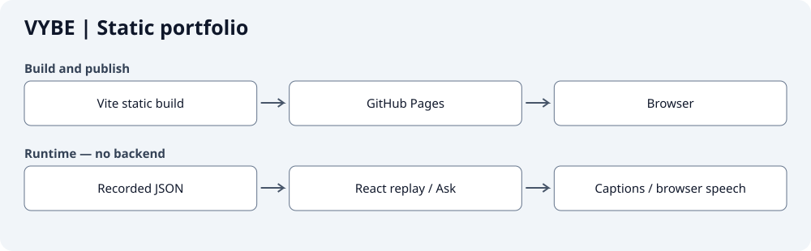
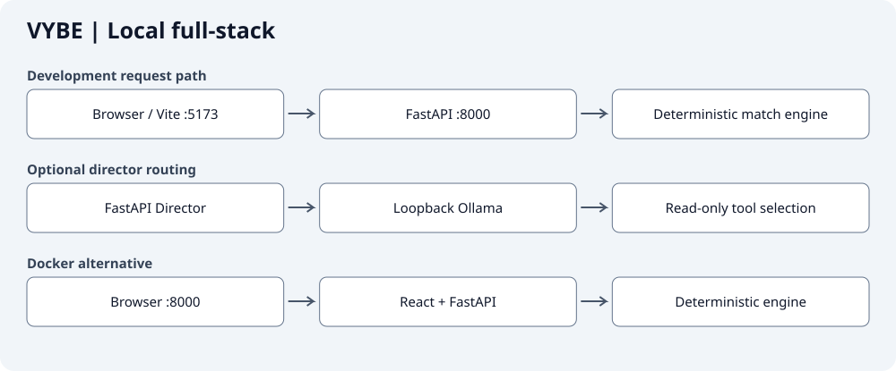
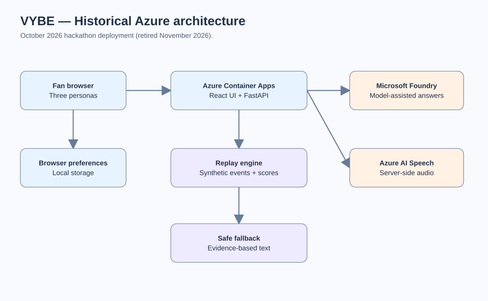

# VYBE — Technical Architecture (November 2026)

VYBE presents **one fictional match** through Young Fan, Accessible Fan, and Analyst Fan experiences. All match scores, events, and evidence IDs derive from synthetic, deterministic data.

## Current public deployment: GitHub Pages

**Public portfolio:** https://hapinam.github.io/vybe-ai/

The public version is a **static React/TypeScript/Vite frontend** built with `VITE_DEMO_MODE=static`. It uses recorded synthetic replay states, insights, narrations, and five predefined Ask the Match answers. Other questions receive a static-demo limitation response.

There is **no live FastAPI backend, Ollama, Microsoft Foundry inference, Azure AI Speech service, or live sports feed** behind the public Pages site. Browser voice capabilities depend on installed browser/OS voices. This is a recorded demonstration, not a live AI service.

## Local full-stack execution (optional)

- **Frontend:** React, TypeScript, Vite; local Vite dev server normally on port 5173.
- **Backend:** Python FastAPI, synthetic match replay, grounded insights, narration and Ask the Match endpoints; normally port 8000.
- **Director:** Optional locally running Ollama for allowlisted read-only tool selection; deterministic fallback remains available. Foundry integration remains in source but requires separately configured services and credentials.
- **Source of truth:** deterministic synthetic event engine, never the language model.

See [project setup](../README.md), [API README](../apps/api/README.md), and [web README](../apps/web/README.md).

The Docker image serves the built frontend and API from one origin. See [local development](LOCAL_DEVELOPMENT.md) for setup and loopback restrictions.

## Historical hackathon deployment — retired

In October 2026, a single Azure Container App served the built React frontend and FastAPI backend. The backend used a Foundry-hosted Azure OpenAI-compatible model for bounded tool selection and narration, with deterministic fallbacks, plus Azure AI Speech when configured. This was **not** a managed Foundry Agent Service agent.

The Azure Container Apps deployment and associated resources have since been retired. The diagram above is **historical**, not the current hosting architecture. The manual Azure deployment workflow is disabled operationally and the former GitHub `azure-demo` environment and credentials were removed. Do not run historical provisioning scripts.

The owner recorded production API responses on October 25, 2026 reporting `foundry_model_tool_call` and `azure_ai` modes. These are owner-observed response records, **not independent Azure-side request traces**. See [immutable historical evidence](archive/VYBE_FOUNDRY_LIVE_EVIDENCE_2026-10-25.md).

## Build and release distinction

- GitHub Pages publishes the static portfolio frontend.
- The [GHCR workflow](GHCR_DEPLOYMENT.md) can publish a SHA-tagged container image after a successful `main` quality gate **when non-documentation changes warrant it**.
- GHCR publishing **does not automatically deploy to Azure**. The Azure workflow is `workflow_dispatch` only and is not operational after retirement.

## Scope and limits

No real Premier League feed, live ingestion, broadcast video, xG, possession calculation, independent inference trace, accessibility certification, or production-grade distributed rate limiting is claimed. Weighted momentum is recorded synthetic event activity, not tactical causation.

Historical implementation plans, acceptance documents, and infrastructure instructions are indexed in [the documentation index](DOCUMENTATION_INDEX.md) and [archive](archive/README.md).
