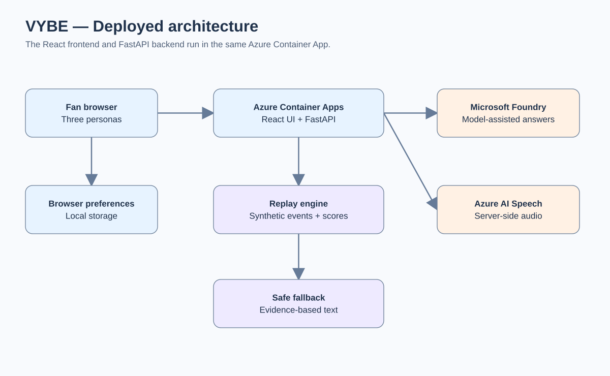

# VYBE — Deployed Technical Architecture (October 2026)

VYBE serves **one fictional match** to three browser personas: Young Fan, Accessible Fan and Analyst Fan. Match state, scores and evidence IDs come from a deterministic Python engine, not the language model.

## Current deployed system

The same container serves the built frontend and FastAPI; there is no separate production Vite server. The frontend makes relative API requests. The Docker image uses a Node build stage and a Python 3.11 runtime with a non-root user.

## What each component actually does

| Component | Implementation | Evidence and limits |
| --- | --- | --- |
| Frontend | React, TypeScript, Vite; three personas; English, Arabic and Czech UI | Accessible preferences stored locally, not synchronized to a cloud account |
| Replay | FastAPI + ordered synthetic events | Source of truth for 2–2 score, shots, passes and evidence IDs |
| Ask the Match | `POST /v1/matches/director/ask` | Model selects an allowlisted read-only data tool; validated output or deterministic fallback |
| Goal narration | `POST /v1/matches/narrate/{event_id}` | Model may select exact verified fact segments; invalid output falls back |
| Speech | `POST /v1/matches/speech` | Server-side Azure AI Speech MP3 with browser voice fallback; availability depends on configuration |
| Deployment | Private GHCR image tagged by commit SHA, deployed to existing Azure Container App | Deployment workflow checks revision health and `/health` before shifting traffic |

**AI boundary:** Microsoft Foundry-hosted Azure OpenAI-compatible model calls are used; this is **not** a managed Foundry Agent Service agent. The model is not authoritative for scores, player facts or tactical causation. Captions and translations are based on synthetic event templates; they are not AI-generated live translation or speech-to-text.

## Production evidence

On **25 October 2026**, the application owner copied two production browser Network responses: Ask the Match reported `generation_mode=foundry_model_tool_call` with `selected_tool=get_key_moments` and evidence IDs; goal narration reported `generation_mode=azure_ai` and validated fact IDs. See [the full evidence pack](VYBE_FOUNDRY_LIVE_EVIDENCE_2026-10-25.md) for exact payloads and provenance. These observations do **not** independently establish upstream Azure inference traces, model billing, or all-browser acceptance.

## Local and cloud execution

- **Local:** Start FastAPI on port 8000, then Vite on 5173. The Vite development proxy forwards `/v1` and `/health` to FastAPI. See [root README](../README.md).
- **Production:** GitHub Actions verifies `main`, publishes the SHA-tagged image to private GHCR, updates the existing `vybe-app` revision, tests its health endpoint, and shifts traffic. See [Azure deployment README](../infra/azure/README.md).
- **Configuration:** Foundry tool selection uses `VYBE_FOUNDRY_MODEL_*`; goal narration uses `VYBE_AZURE_OPENAI_*`. Azure Speech is separately configured on the server. Never expose credentials to the browser or commit them.
- **Release control:** Keep the previous Container Apps revision available for rollback. Merging to `main` may trigger deployment.

## Safety and scope

No real Premier League match feed, broadcast footage, live ingestion, event generator service, queue, Terraform-managed infrastructure, or managed agent orchestration is claimed. The analytics show weighted recorded event activity, not xG, possession or tactical inference. The API rate guard is in-process and peer-based, not a distributed per-user limit.

## Future possibilities (not deployed)

Streaming ingestion, richer telemetry, distributed rate limiting, multilingual expansion and specialized agents are roadmap ideas. See [product roadmap](PRODUCT_VISION_ROADMAP.md); do not confuse these with the current deployment.
