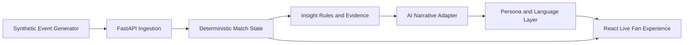

# VYBE — Technical Architecture (MVP)

## Design principles
- **Facts first:** deterministic state computes score, possession proxies, shots, and event sequences.
- **Narratives second:** the AI layer receives only validated structured facts, evidence, and persona guidance.
- **Graceful fallback:** templates produce usable narratives if cloud AI is unavailable.
- **Streamable:** start with polling or Server-Sent Events; add messaging services only if load requires them.
- **Cloud-native:** containerized Python FastAPI API and React TypeScript UI; deploy to Azure Container Apps.
- **Observable:** structured logs, correlation IDs, latency and error metrics; Azure Monitor / Application Insights.
- **Secure:** no secrets in git; environment configuration and least-privilege Azure access.

## Agentic roadmap
Introduce specialized agents for event interpretation, narrative composition, and factual verification. Use Microsoft Foundry when the deterministic MVP is working; measure accuracy and latency before adding more orchestration.

## Initial repository layout
- `apps/api/` — ingestion, match state, insight generation, tests
- `apps/web/` — accessible live fan interface
- `data/` — synthetic match fixtures
- `infra/` — Azure deployment and Terraform
- `docs/` — product, architecture, evaluation and demo plan

## Out of scope for first MVP
Real match feeds, copyrighted broadcast footage, automated video recognition, unsupported predictions, and unnecessary Kubernetes complexity.
