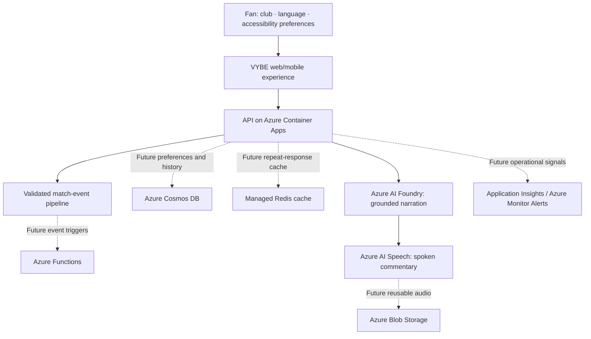

# VYBE — Product Vision & Future Roadmap

> **For hackathon judges — proposed future work, not shipped functionality.**
>
> VYBE's current demo uses a **synthetic football match** and three fan experiences: Young Fan, Accessible Fan, and Analyst Fan. Its existing React/FastAPI architecture, deterministic match engine, and evidence-constrained Azure AI Foundry integration provide a foundation for expansion. Cloud-generated speech is being developed separately and must not be presented as live until verified.

## Vision

**Every fan belongs — across languages, abilities, clubs, devices, and match moments.**

VYBE aims to grow from a single-match accessibility and personalization demonstration into an inclusive football companion: multilingual commentary, fan-selected perspectives, resilient event delivery, and personalized post-match stories. The product would remain transparent about what is simulated, AI-generated, or verified from licensed data.

## Future architecture decision: scalable multilingual commentary

**Status:** Architectural backlog item only; **not implemented in the current Egyptian Arabic speech-fix PR**. Keep the existing three-language implementation and focused pronunciation/clock normalization for now.

**Current limitation:** Speech output is split between Azure AI Speech (text-to-speech) and browser TTS fallback, while some spoken strings, match-clock formatting, number words, and localized introductions are hardcoded separately in Python and TypeScript. Azure Speech reads supplied text; it does **not** generate the football commentary itself. Adding languages by copying these rules would increase duplication and regression risk.

**Future target architecture:**

1. Consume validated, structured match events (including score, team, player, match minute and second), never free-form invented match facts.
2. Use a single language-agnostic commentary contract. Generate localized, persona-aware commentary using the existing grounded AI narrative adapter when available, with deterministic localized templates as an offline/failed-AI fallback.
3. Configure language, locale, Azure Speech voice, speech rate and optional pronunciation lexicon centrally; keep voice and text generation responsibilities separate.
4. Apply a small, language-aware speech-pronunciation layer only for exceptions such as brand names and player names. Prefer provider-supported SSML/phonemes where validated, rather than embedding complete translations and number grammars in both frontend and backend.
5. Share or contract-test normalization behavior between Azure TTS and browser fallback. Preserve readable captions, accessibility, RTL layout and the original match facts.
6. Roll out additional languages behind explicit availability checks for Azure voices, native-speaker reviews, football terminology tests, boundary-clock tests, voice playback tests, latency and cost monitoring.

**Acceptance criteria for the future refactor:** Adding a supported language should normally require configuration, localized UI resources and validation—not duplicate clock/number implementations in multiple services. Existing English, Egyptian Arabic and Czech experiences must retain regression coverage. The fallback must remain functional when Foundry or Azure Speech is unavailable.

**Non-goal for the current PR:** Do not redesign the commentary pipeline, introduce new Azure resources, or expand the supported language list while fixing Egyptian pronunciation.

## Proposed roadmap

| Horizon | Proposed fan-facing capability | Potential Microsoft Azure technology | Success criteria |
| --- | --- | --- | --- |
| **Phase 1 — Accessibility & localization** | Expand beyond English, Arabic, and Czech; localized captions and consistent spoken commentary; optional voice preferences | **Azure AI Speech**, optionally **Azure AI Translator**; Azure AI Foundry for constrained language generation | Correct names, scores, match minutes and pronunciation across devices; language quality reviewed by native speakers |
| **Phase 2 — Faster repeat experiences** | Reuse previously generated audio and safe, identical match responses, reducing wait time | **Azure Cache for Redis** (or an appropriate managed Redis offering), with optional **Azure Blob Storage** for MP3 objects | Lower median audio start time, fewer repeated Speech calls, bounded cache cost |
| **Phase 3 — Fan preferences & match history** | Favorite club, player focus, language and accessibility preferences, saved recaps | **Azure Cosmos DB** | Consent-based preferences, reliable retrieval, deletion/export controls, no unnecessary personal data |
| **Phase 4 — Event-driven match experiences** | Ingest and validate match events, trigger commentary, quizzes and recaps asynchronously | **Azure Functions** plus appropriate queue/event transport | Idempotent event processing, retry and replay behavior, no duplicated goals or commentary |
| **Phase 5 — Production reliability** | Detect degraded narration, Speech errors, API latency and abnormal cost trends | **Azure Monitor Alerts** with **Application Insights / Log Analytics** as appropriate | Actionable alerts, measurable service health, controlled telemetry ingestion |

These are **candidate technologies**, not commitments to deploy every service. Each phase requires an explicit cost, security, accessibility and reliability review.

## Future roadmap: real-match selection and live feeder

VYBE's long-term goal is to let fans choose **real football matches**, rather than expanding the demo with more fictional fixtures. A Match Center would list real upcoming, live, and completed matches from competitions supported by a licensed football-data provider.

After selecting a match, the fan could see its verified teams, kickoff, score, events, and available statistics. Young Fan, Accessible Fan, and Analyst Fan modes would adapt their commentary and insights to the selected real match, with multilingual text and speech. Completed matches could offer replays and recaps where licensing permits.

### Proposed data flow

1. A **licensed football-data API** provides fixtures and authorized live match events.
2. **Azure Functions** validates and processes incoming updates, with safeguards against duplicates and out-of-order events.
3. **Azure Cosmos DB** could store permitted match catalogs, state, and opt-in fan preferences.
4. A managed **Redis cache** could reduce repeated requests and latency for frequently viewed fixtures.
5. **Azure AI Foundry** and **Azure AI Speech** could deliver grounded, personalized commentary without inventing match facts.
6. **Azure Monitor Alerts** could flag feed failures, stale events, unusual latency, and operational cost issues.

Before implementation, the team would assess provider licensing, league coverage, redistribution rights, attribution, update limits, accuracy, latency, privacy, and ongoing costs. If the live feed is delayed or unavailable, VYBE should disclose that rather than presenting simulated events as live.

**Scope:** This is a post-hackathon vision, not a feature available in today's single-synthetic-match demo. No real-data subscription or additional Azure infrastructure is required for the current submission.

**For judges:** “Today VYBE demonstrates inclusive AI commentary on a synthetic match. Our future Match Center will let fans choose real football fixtures and enjoy the same personalized experience on matches they care about, supported by licensed live data and a phased Azure architecture.”

## How the future system could work

## Design principles and safeguards

1. **Evidence first:** Scores, scorers, timestamps and match statistics must come from validated events. Generative AI may adapt presentation but must not invent match facts.
2. **Accessibility by default:** Captions remain available without sound; keyboard and screen-reader workflows must continue to work.
3. **Responsible multilingual rollout:** Add languages gradually; test translation, football terminology, pronunciation, RTL layouts and locale-specific numbers before release.
4. **Privacy and control:** Make personalization opt-in; minimize stored data; document retention, export and deletion before introducing accounts.
5. **Reliability:** Event consumers must be idempotent; audio generation needs graceful failure and a usable text-only fallback.
6. **Cost discipline:** Prefer a small demonstrable solution; use quotas, caching, monitoring and budget alerts; provision new Azure resources only when usage justifies them.
7. **Real-world data is a separate milestone:** The demo's match and clubs are fictional. Any future live football feed would require appropriate licensed data, attribution and usage rights.

## Suggested 45-second judges' pitch

> “VYBE starts with one fictional match and three ways to experience football: Young Fan, Accessible Fan and Analyst Fan. We use deterministic match facts with Azure AI Foundry to make commentary engaging without letting AI invent the score. Our next step is consistent Azure Speech narration and a broader multilingual experience. Beyond the hackathon, we envision fans choosing their club, favorite players and accessibility settings; Cosmos DB could preserve those preferences, Redis could accelerate repeated experiences, Azure Functions could process verified match events, and Azure Monitor could help us operate reliably. These are planned capabilities—not features we claim are live today. Our goal is simple: make football feel accessible and personal to every fan.”

## What is **not** part of the current demo

- Real Premier League match feeds or officially licensed live data.
- Accounts, persistent fan profiles, favorite-club or player-focus personalization.
- Cosmos DB, Redis cache, Functions-based event ingestion, or Azure Monitor alerting.
- More than the current three supported interface/commentary languages.
- A production service-level guarantee.

**Judge-facing principle:** Demonstrate the present honestly; describe the roadmap as a credible, phased future.
